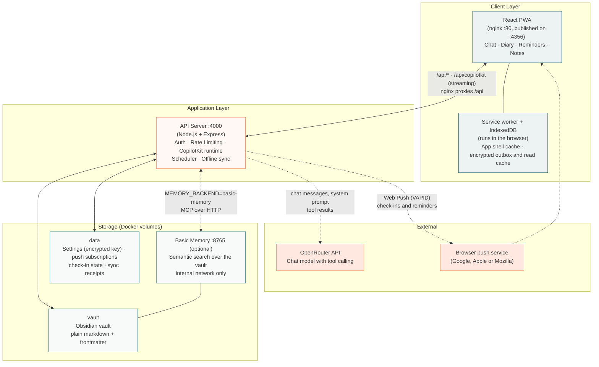

# Clio — Smart Diary, Notes & Reminders Agent


A self-hosted, containerized, mobile-first Progressive Web App for your diary, notes and reminders. You talk to Clio in a chat that answers with real interface (reminder cards, mood charts, checklists, a daily check-in form), it nudges you every day to write something down, and everything it knows lives as **plain markdown in an Obsidian vault** that you own.

Your notes stay on your own server. The only outside calls are the chat (sent to OpenRouter and the model you choose) and Web Push notifications (sent through your browser's push service).
---

## Table of Contents

- [Architecture](#architecture)
- [Component Stack](#component-stack)
- [Privacy & Safety](#privacy--safety)
- [Quick Start](#quick-start)
- [Local Development (without Docker)](#local-development-without-docker)
- [Using Clio](#using-clio)
- [Your Vault](#your-vault)
- [Offline Mode](#offline-mode)
- [Notifications](#notifications)
- [Settings](#settings)
- [Look and Feel](#look-and-feel)
- [PWA Features](#pwa-features)
- [HTTPS](#https)
- [REST API Reference](#rest-api-reference)
- [Configuration Reference](#configuration-reference)
- [Limits and Rate Limiting](#limits-and-rate-limiting)
- [Backups](#backups)
- [Troubleshooting](#troubleshooting)
- [Docker Container Reference](#docker-container-reference)
- [Project Structure](#project-structure)
- [OpenRouter](#openrouter)
- [Basic Memory (Optional)](#basic-memory-optional)
- [Known Gaps](#known-gaps)
- [License](#license)

---

## Architecture



### Request Flow

1. You sign in with `CLIO_PASSWORD`. The API returns a session token that the app sends as `X-Session-Token` on every request.
2. In a chat, the browser streams the conversation to `/api/copilotkit`. The CopilotKit runtime sends it to OpenRouter together with Clio's tools (append to today's note, create a note or reminder, complete or snooze a reminder, search your vault, update your profile).
3. When the model calls a tool, the API reads or writes the markdown files in the vault and sends the result back to the model. Frontend actions draw the answer as cards in the chat (reminders, mood chart, search results, check-in form, note preview).
4. Anything destructive, such as deleting a reminder, appears as a confirmation card first and only runs when you approve it.
5. Every minute the scheduler checks your check-in times and due reminders and sends Web Push notifications to the devices you enabled.

### Component Stack

| Component | Technology | Role |
|-----------|------------|------|
| **Chat with generative UI** | [CopilotKit](https://github.com/CopilotKit/CopilotKit) 1.90 (runtime + React) | Streams the chat, runs server tools, draws frontend cards |
| **AI model** | [OpenRouter](#openrouter) via `@ai-sdk/openai-compatible` | Any OpenRouter model that supports tool calling |
| **API Server** | Node.js 20 + Express, helmet, express-rate-limit, zod | REST API, auth, rate limiting, validation |
| **Storage** | Markdown files with frontmatter (`gray-matter`) | Obsidian-compatible vault; no database |
| **Search** | [MiniSearch](https://github.com/lucaong/minisearch) (default) or [Basic Memory](#basic-memory-optional) | Keyword search over the vault, or optional semantic search |
| **Scheduler** | `node-cron` + `web-push` | Daily check-in nudges and reminder notifications |
| **Frontend** | React 18 + TypeScript + Vite 5 + Tailwind CSS + daisyUI | Mobile-first UI, light and dark |
| **Charts and maps** | Recharts, Leaflet | Mood charts, place picker |
| **Offline** | Service worker + IndexedDB (`idb`), Web Crypto AES-GCM | App shell cache, encrypted offline outbox and read cache |
| **Web server** | nginx | Serves the PWA and proxies `/api` to the backend |
| **Containers** | Docker Compose | Two services, one optional service, three volumes |

---

## Privacy & Safety

Clio holds your diary/journal, so it is private by default. Full details: [docs/PRIVACY.md](docs/PRIVACY.md).

### Safeguards

- **Single owner, password sign-in.** Every `/api` route except sign-in needs a session token. Sessions last `SESSION_TTL_HOURS` and are lost when the API restarts.
- **Brute-force protection.** 5 sign-in attempts per minute per IP, and a 15-minute lockout after 5 failed passwords.
- **Private diary.** Daily notes and journal entries are written with `private: true`. Clio only retrieves past private entries when you turn on **Share private diary with Clio this session** on the Chat tab, and it is off again at every new sign-in. What you type in the current conversation is always sent to the AI provider.
- **Nothing is ever deleted.** Reminders, notes, diary days and journal entries are **archived** instead: hidden from the normal lists (and from notifications), kept in the vault and in backups, and restorable from each screen's *Archived* view. Clio's AI cannot overwrite a note, and archiving a reminder from the chat always shows a confirmation card first.
- **Prompt-injection guard.** Text from your notes reaches the model only inside `<note_content>` tags with `<` and `>` escaped, and the system prompt says it is data, not instructions.
- **Encrypted secrets.** The OpenRouter key saved in Settings is encrypted with AES-256-GCM using a key derived from `SECRET_KEY`, and it is never sent back to the browser.
- **Encrypted offline data.** Notes and changes made offline are stored in the browser encrypted with a key derived from your password, kept only in memory.
- **No telemetry.** CopilotKit telemetry is disabled, and the frontend loads no third-party scripts at runtime.

> **What is not protected:** the vault itself is plain markdown, because the server has to read your notes to search them and to let the AI use them. Encrypt the host disk or volume if you need encryption at rest.

---

## Quick Start

### Prerequisites

- Docker Engine 24+ and Docker Compose v2.24+
- An [OpenRouter](https://openrouter.ai) API key for the chat (can also be added later in Settings)
- *Optional:* Node.js, to generate VAPID keys with `npx web-push` for push notifications

### 1 — Configure

```bash
cp .env.example .env
```

Clio has **one** `.env` file, at the repository root. Set at least:

```env
CLIO_PASSWORD=a-good-password
SECRET_KEY=at-least-32-random-characters-xxxxxxxxxxxx
TZ=Europe/Berlin
OPENROUTER_API_KEY=sk-or-v1-xxxxxxxxxxxxxxxx
```

For notifications, generate a VAPID key pair and paste it into `VAPID_PUBLIC_KEY` and `VAPID_PRIVATE_KEY`:

```bash
npx web-push generate-vapid-keys
```

### 2 — Start the Stack

```bash
docker compose up --build -d

# Follow the API logs
docker compose logs -f clio-api
```

The public VAPID key is baked into the frontend at build time, so after changing it run `docker compose up --build -d` again.

### 2a — Rebuilding After Code Changes

Your notes live in the named volumes `vault` and `data`, so rebuilding never touches them.

```bash
docker compose up --build -d                       # rebuild what changed
docker compose up --build --force-recreate clio-api
docker compose up --build --force-recreate clio-web
```

> **Never run `docker compose down -v`.** It deletes the `vault` and `data` volumes, which hold all your notes. `docker compose down` (without `-v`) is safe.

### 3 — Open the App

**http://localhost:4356**

Sign in with `CLIO_PASSWORD`, then open **Settings** to check your timezone, set the check-in times, press **Enable notifications**, and (if you did not put the key in `.env`) paste your OpenRouter key and press **Test key**.

> **Use HTTPS for anything but localhost.** Browsers only allow push notifications, service workers and the encryption used for offline mode on secure origins. See [HTTPS](#https).

### 4 — Check the Install

```bash
CLIO_PASSWORD=... scripts/smoke.sh                 # default http://localhost:4356
```

The smoke test checks health, sign-in, that unauthenticated requests are rejected, and that a reminder lands in the vault as a markdown file.

---

## Local Development (without Docker)

Requires Node.js 20+.

### Backend

```bash
cd backend
npm ci
CLIO_PASSWORD=x SECRET_KEY=<32+ chars> VAULT_DIR=/tmp/v DATA_DIR=/tmp/d API_PORT=4000 node src/index.js
```

`npm run dev` restarts the server on file changes.

### Frontend

```bash
cd frontend
npm ci
npm run dev                                        # http://localhost:5173, proxies /api to localhost:4000
```

`npm run build` produces the production bundle in `frontend/dist`, and `npm run typecheck` runs `tsc`.

### Tests

```bash
cd backend  && npx vitest run                      # API, vault, scheduler, sync, backup
cd frontend && npx vitest run                      # UI, outbox, store
bash scripts/test-backup.sh                        # backup/restore round trip
bash scripts/check-env-docs.sh                     # README and .env.example list the same variables
```

---

## Using Clio

Clio has four tabs in the bottom navigation. Each has its own chat thread with Clio (text only), so what you say in Reminders does not mix with Diary or Notes.

| Tab | What it shows | Ask Clio to… |
|-----|---------------|--------------|
| **Chat** | The main conversation | Note what happened, a thought or an idea; show reminders, a mood chart or search results; start a check-in |
| **Diary** | Daily notes and mood, with a day strip and Clio's reflections | Reflect on the last days, show a specific day |
| **Reminders** | Due, upcoming, snoozed and done reminders | Create, complete, snooze or reschedule reminders; turn a plan into tasks |
| **Notes** | Notes and checklists; tick items off directly | Find or preview a note |

- **Daily check-in.** Tap the notification, or ask Clio to start a check-in. Your mood and text go into today's note, then Clio asks a follow-up.
- **+ Note.** Quick capture that works offline. A badge shows how many changes are waiting to sync.
- **Diary entries** can carry photos, people and places (picked on a map).
- **Generative cards.** Clio answers with cards you can act on: reminder lists, checklists, mood charts, search results, reschedule suggestions, note previews and confirmation cards.

---

## Your Vault

The vault is a folder inside the `vault` volume:

```
Clio/Daily/YYYY-MM-DD.md       daily note (frontmatter: date, mood, energy, tags, private)
Clio/Notes/<slug>.md           notes and ideas (offline conflicts: <slug>.conflict-<id>.md)
Clio/Events/<date>-<id>.md     journal entries from the Journal view
Clio/Reminders/<id>.md         reminders (due, priority, repeat, done, ...)
Clio/Memory/Profile.md         facts Clio remembers about you (you can edit it)
Clio/Attachments/              photos (jpg, png, webp, gif), linked from daily notes
```

Clio only **appends** to daily notes and **creates** new notes. It never rewrites your text without an approval card, and a file Obsidian left with broken frontmatter is reported, never silently overwritten.

### Open It in Obsidian (Git or Syncthing)

The vault lives on the server, so desktop Obsidian needs a synced copy. Pick one:

**Git (recommended: history and visible conflicts).** Create a private Git repository for the vault, then on the server:

```bash
docker compose exec clio-api sh -c 'cd /vault && git init -b main && git add -A && git commit -m "snapshot"'
```

Add a remote and push on a schedule (cron on the host running `docker compose exec`). On your desktop `git clone` the repository and open that folder as an Obsidian vault (the Obsidian Git plugin can pull and push automatically).

**Syncthing.** Mount the `vault` volume into a Syncthing container (add it to `docker-compose.yml`) and share the folder with your desktop.

Edits made in Obsidian and in Clio at the same time can collide. Clio detects changes by file hash and keeps both versions rather than overwriting; with Git you also see them as merge conflicts.

---

## Offline Mode

- **What works offline:** writing notes, creating and changing reminders (create, edit, complete, snooze, archive), check-ins and diary entries, including photos. The last data you loaded stays readable.
- **How it is stored:** pending changes and the read cache live in IndexedDB, encrypted with AES-GCM-256. The key is derived from your password (PBKDF2-SHA256) and kept only in memory, so after a reload you sign in again to unlock them.
- **How it syncs:** when the connection returns, changes are sent in the order you made them (`POST /api/sync/notes` and `/api/sync/ops`). Each change has an id, so resending a batch is safe. The header shows **offline**, **syncing** or **online**.
- **Conflicts:** if a note changed on the server meanwhile, both versions are kept and shown so you can choose. A reminder change that can no longer apply (for example, the reminder was changed elsewhere) is dropped with a message.
- **What needs a connection:** the chat with Clio and search.

---

## Notifications

Clio sends Web Push notifications from the server, so they arrive even when the app is closed.

| Notification | When |
|--------------|------|
| **Morning check-in** | At the morning time (default `09:00`) |
| **Evening nudge** | At the evening time (default `20:30`), only if you have not written anything today |
| **Reminder** | When a reminder is due; shows its title and the start of its notes |

Times are in the timezone set in Settings (`TZ` by default). Notifications need the VAPID key pair; without it the API logs `VAPID keys not set` and sends none.

---

## Settings

The Settings page lets you:

- Paste an **OpenRouter key**, choose a **model** from OpenRouter's list, and press **Test key**. A key saved here wins over `OPENROUTER_API_KEY` and is never sent back to the browser.
- Set the **timezone** and the morning and evening **check-in times**.
- **Enable notifications** on this device.
- Switch between **light and dark** themes.

---

## Look and Feel

The interface uses a teal and orange design, light and dark (dark by default). All colors are CSS variables at the top of `frontend/src/index.css`, so the theme can be retuned in one place.

| Color | Hex | Used for |
|-------|-----|----------|
| **Teal** | `#0D4C55` | Primary surfaces and actions |
| **Teal light** | `#146B78` | Hover and secondary accents |
| **Ember** | `#FF6B35` | Highlights and calls to action |
| **Canvas** | `#F8FAFA` | Light background |
| **Ink** | `#131E22` | Text |

It is built for phones first: a single column, a bottom navigation with four tabs, and bottom sheets for forms. Animations switch off for users who prefer reduced motion.

---

## PWA Features

- Installable on mobile and desktop (`manifest.json`, 192 and 512 px icons)
- App shell cached for offline use; navigations are network-first, so a new deployment is never hidden by an old page
- API requests are never served from the service-worker cache
- Push notifications handled by the service worker, which opens the right tab when tapped

---

## HTTPS

Put a reverse proxy with a certificate in front of port 4356. Example with Caddy:

```
clio.example.com {
    reverse_proxy localhost:4356
}
```

Set `CORS_ORIGIN=https://clio.example.com` and `TRUST_PROXY_HOPS=2` if the request passes through two proxies (default 1: nginx only).

---

## REST API Reference

All `/api` routes except sign-in need the `X-Session-Token` header. Through the bundled nginx the same paths are available on port `4356`.

### Health and Sign-In

```bash
curl http://localhost:4356/health
# → { "status": "ok" }

curl -X POST http://localhost:4356/api/auth/login \
  -H "Content-Type: application/json" \
  -d '{"password": "your-password"}'
# → { "token": "..." }
```

### Endpoints

| Path | Method | Purpose |
|------|--------|---------|
| `/api/daily`, `/api/daily/:date` | `GET` | List daily notes, read one day (`YYYY-MM-DD`) |
| `/api/daily/:date` | `PUT` | Replace a day's editable content |
| `/api/daily/:date/entries` | `POST` | Append an entry (text, mood, photo, people, place) |
| `/api/reminders` | `GET` `POST` | List or create reminders (`?archived=true` lists archived ones) |
| `/api/reminders/:id` | `PUT` | Update a reminder |
| `/api/reminders/:id/archive`, `/api/reminders/:id/unarchive` | `POST` | Archive or restore a reminder (there is no delete) |
| `/api/reminders/:id/complete`, `/api/reminders/:id/snooze` | `POST` | Complete or snooze a reminder |
| `/api/journal` | `GET` `POST` | List or create journal entries (`?archived=true` lists archived ones) |
| `/api/journal/:id` | `PUT` | Update a journal entry |
| `/api/journal/:id/archive`, `/api/journal/:id/unarchive` | `POST` | Archive or restore a journal entry |
| `/api/daily/archived` | `GET` | List archived diary days |
| `/api/daily/:date/archive`, `/api/daily/:date/unarchive` | `POST` | Archive or restore a diary day |
| `/api/notes`, `/api/notes/read` | `GET` | List notes, read one note |
| `/api/notes/checklist` | `PATCH` | Tick or untick a checklist item |
| `/api/notes/archive` | `POST` | Archive or restore a note (`{ path, archived }`); `GET /api/notes?archived=true` lists archived notes |
| `/api/search?q=…` | `GET` | Search the vault |
| `/api/analytics/mood` | `GET` | Mood over time |
| `/api/attachments` | `POST` | Upload a photo (base64 JSON, up to 4 MB) |
| `/api/attachments/:file` | `GET` | Download a photo |
| `/api/sync/notes`, `/api/sync/ops`, `/api/sync/resolve` | `POST` | Sync offline changes, resolve a note conflict |
| `/api/session/share` | `GET` `POST` | Read or set the private-diary sharing for this session |
| `/api/settings` | `GET` `PUT` | Read or change settings (never returns the key itself) |
| `/api/settings/models` | `GET` | OpenRouter model list |
| `/api/settings/test-key` | `POST` | Check the saved OpenRouter key |
| `/api/push/vapid-public-key` | `GET` | Public VAPID key |
| `/api/push/subscribe`, `/api/push/unsubscribe` | `POST` | Register or remove this device for notifications |
| `/api/checkin/snooze` | `POST` | Snooze today's check-in nudge |
| `/api/backup/export` | `POST` | Everything under `Clio/` as one JSON export (the app encrypts it) |
| `/api/backup/restore/files`, `/api/backup/restore/finish` | `POST` | Restore in batches, then optionally remove what the backup did not have |
| `/api/copilotkit` | `POST` | CopilotKit chat endpoint (streaming) |

Example:

```bash
TOKEN=...
curl -X POST http://localhost:4356/api/reminders \
  -H "X-Session-Token: $TOKEN" -H "Content-Type: application/json" \
  -d '{"title": "Call the dentist", "due": "2026-12-01T09:00:00Z"}'
```

### Errors

Errors return JSON: `{ "error": "..." }`, sometimes with a `message`.

| Status | Error | Cause |
|--------|-------|-------|
| `400` | `invalid` | Request body or parameter failed validation (`message` says which) |
| `400` | `password_required`, `invalid_json`, `invalid_path` | Missing password, malformed JSON, or a path outside the vault |
| `401` | `unauthorized`, `invalid` | Missing or expired session token, or wrong password |
| `404` | `not_found` | The note, reminder or file does not exist |
| `409` | `conflict`, `parse_error` | The file changed meanwhile, or its frontmatter cannot be read |
| `413` | `too_large` | Request body over the [size cap](#limits-and-rate-limiting) |
| `429` | `rate_limited`, `locked` | [Rate limit](#limits-and-rate-limiting) exceeded, or sign-in locked after failed attempts |
| `500` | `internal` | Unexpected server error (details in the API log) |

---

## Configuration Reference

All settings live in a single `.env` file at the repository root (copy `.env.example`). Compose also sets `API_PORT`, `VAULT_DIR` and `DATA_DIR` for the API container; you normally don't touch them. `scripts/check-env-docs.sh` checks that this table and `.env.example` list the same variables.

| Variable | Default | Description |
|----------|---------|-------------|
| `PORT` | `4356` | Public port of the web container |
| `TZ` | `UTC` | Your timezone; defines "today" and the check-in times (also editable in Settings) |
| `CLIO_PASSWORD` | required | Sign-in password (single owner) |
| `SECRET_KEY` | required | At least 32 characters; encrypts the saved OpenRouter key |
| `OPENROUTER_API_KEY` | — | Enables the chat; a key saved in Settings wins |
| `OPENROUTER_MODEL` | `openai/gpt-4o-mini` | Model id; pick one that supports tool calling |
| `OPENROUTER_BASE_URL` | `https://openrouter.ai/api/v1` | Only for a proxy or tests |
| `MEMORY_BACKEND` | `plain` | `plain` or `basic-memory` |
| `BASIC_MEMORY_URL` | `http://basic-memory:8765/mcp` | Where the optional Basic Memory container listens |
| `VAPID_PUBLIC_KEY` | — | Web-push public key; without the VAPID pair no notifications are sent. Also baked into the frontend at build time |
| `VAPID_PRIVATE_KEY` | — | Web-push private key |
| `VAPID_SUBJECT` | `mailto:admin@example.com` | Contact URI for the push service |
| `SESSION_TTL_HOURS` | `8` | How long a sign-in lasts |
| `CORS_ORIGIN` | none | Comma-separated allowed origins (only needed when the UI is on another origin) |
| `TRUST_PROXY_HOPS` | `1` | Number of proxies in front of the API (for per-IP rate limits) |
| `BACKUP_PASSPHRASE` | — | Passphrase for `scripts/backup.sh` / `restore.sh` |

The API refuses to start if `CLIO_PASSWORD` is missing, `SECRET_KEY` is shorter than 32 characters, `TZ` is not a valid timezone, or `MEMORY_BACKEND` has another value.

---

## Limits and Rate Limiting

| Limit | Default | Applies to |
|-------|---------|------------|
| **Sign-in rate** | 5 per minute per IP | `POST /api/auth/login` |
| **Sign-in lockout** | 15 minutes after 5 failures | Per IP |
| **Chat rate** | 20 per minute per IP | Agent runs on `/api/copilotkit` (the calls that reach the model) |
| **API rate** | 300 per minute per IP | All `/api` routes |
| **Body size** | 1 MB | Most `/api` routes |
| **Chat body size** | 100 KB | `/api/copilotkit` |
| **Bulk body size** | 5 MB | `/api/attachments`, `/api/sync/ops` (`/api/backup`: 30 MB, signed-in only) |
| **Photo size** | 4 MB | Each attachment |
| **Proxy timeout** | 300 seconds | nginx, for streaming chat responses |

### How It Works

- **Per-IP counting.** Limits are counted per client IP as the API sees it; `TRUST_PROXY_HOPS` tells it how many proxies to skip. Responses carry the standard `RateLimit` headers, and a client over the limit gets `429 { "error": "rate_limited" }`.
- **Chat setup calls are cheap.** CopilotKit's frequent setup calls fall under the general API limit; only agent runs count against the chat limit.
- **Sessions are in memory.** Restarting the API signs everyone out.

---

## Backups

```bash
BACKUP_PASSPHRASE='long passphrase' scripts/backup.sh ~/clio-backups
```

Writes one encrypted file with the `vault` and `data` volumes. Restore and details: [scripts/BACKUP_README.md](scripts/BACKUP_README.md).

**From the app:** *Menu → Backup & restore* downloads one file with everything under `Clio/` in the vault: reminders, notes, diary days, journal entries, photos and Clio's profile memory. It is encrypted in the browser (AES-256-GCM, PBKDF2-SHA256 with 600,000 rounds) with a password you choose; the server never sees it. Restoring shows what the file holds first, then either **replaces** (items not in the backup are archived, never deleted) or **merges**. Settings and the API key are not included. Older app backups (reminders and journal only) can still be restored. Your notes are also plain markdown, so a Git remote or Syncthing copy of the vault is a second backup.

---

## Troubleshooting

**The API container exits on start**

Check `docker compose logs clio-api`. The usual causes are a missing `CLIO_PASSWORD`, a `SECRET_KEY` shorter than 32 characters, or an invalid `TZ`.

**The chat says the AI is not configured, or answers fail**

Add an OpenRouter key in Settings and press **Test key**, or set `OPENROUTER_API_KEY` in `.env` and restart the API. Choose a model that supports tool calling.

**No notifications arrive**

- Set both `VAPID_PUBLIC_KEY` and `VAPID_PRIVATE_KEY`, then rebuild with `docker compose up --build -d` (the public key is built into the frontend).
- Open the app over HTTPS or `localhost`; browsers block push and service workers elsewhere.
- Press **Enable notifications** in Settings on each device, and allow notifications in the browser.

**`429` on sign-in**

Too many attempts, or the 15-minute lockout after 5 wrong passwords. Wait and try again.

**Offline notes are locked after a reload**

The offline key lives only in memory. Sign in again to unlock and sync them.

**An edit in Obsidian did not show up, or a note appeared twice**

Clio and Obsidian edited the same file at once. Clio keeps both versions (`<slug>.conflict-<id>.md`) rather than overwriting; merge them by hand.

**CORS errors**

These only occur when the UI is served from another origin. Set `CORS_ORIGIN` to that origin.

---

## Docker Container Reference

| Service | Image | Ports | Purpose |
|---------|-------|-------|---------|
| `clio-web` | Built from `frontend/` (`node:20-alpine` build, served by `nginx:1.27-alpine`) | `4356:80` | PWA and `/api` proxy |
| `clio-api` | Built from `backend/` (`node:20-alpine`) | internal `4000` | REST API, CopilotKit runtime, scheduler |
| `basic-memory` | Built from `basic-memory/` (`python:3.12-slim`), profile `memory` | internal `8765` | Optional semantic search |

| Volume | Mounted at | Purpose |
|--------|------------|---------|
| `vault` | `/vault` (`clio-api`, `basic-memory`) | Your Obsidian vault: all notes |
| `data` | `/data` (`clio-api`) | Settings, push subscriptions, check-in state, sync receipts |
| `bm-config` | `/config` (`basic-memory`) | Basic Memory configuration and index |

Useful commands:

```bash
docker compose ps
docker compose logs -f clio-api
docker compose --profile memory up -d              # with Basic Memory
```

The API's log is capped at 1 MB × 2 files, because the AI library logs failed requests, including your messages.

---

## Project Structure

```
clio/
├── backend/
│   ├── src/
│   │   ├── index.js              # Wires services together and starts the server
│   │   ├── app.js                # Express app, helmet, CORS, rate limits, body caps
│   │   ├── routes.js             # Mounts every /api router
│   │   ├── config.js             # Reads and validates environment variables
│   │   ├── controllers/          # One router per area (daily, reminders, notes, sync, push, ...)
│   │   ├── services/             # Vault, daily, reminders, notes, scheduler, push, sync, settings
│   │   │   └── memory/           # Plain keyword search and Basic Memory client
│   │   ├── copilot/              # CopilotKit runtime, server tools, prompt-injection guard
│   │   └── __tests__/
│   ├── package.json
│   └── Dockerfile
├── frontend/
│   ├── src/
│   │   ├── App.tsx               # App shell, tabs, online/sync status
│   │   ├── pages/                # Chat, Diary, Reminders, Notes, Settings
│   │   ├── components/
│   │   │   ├── chat/             # Chat UI
│   │   │   ├── gen/              # Generative cards (reminders, mood chart, check-in, ...)
│   │   │   ├── layout/           # Header, bottom navigation
│   │   │   ├── media/            # Photo, people and place pickers
│   │   │   └── ui/               # Shared primitives
│   │   ├── copilot/              # Frontend actions and per-tab chat scopes
│   │   ├── offline/              # Encrypted outbox, read cache, sync
│   │   ├── lib/                  # API client, auth, push, theme
│   │   └── index.css             # Teal and orange theme tokens
│   ├── public/                   # sw.js, manifest, icons, logo
│   ├── nginx.conf                # SPA + /api proxy
│   ├── vite.config.ts
│   └── Dockerfile
├── basic-memory/Dockerfile       # Optional semantic search container
├── scripts/                      # backup, restore, smoke test, env-doc check
├── docs/                         # Design, plans, privacy, history
├── .env.example                  # Single configuration file
├── banner.png
├── docker-compose.yml
└── README.md
```

---

## OpenRouter

[OpenRouter](https://openrouter.ai) is the cloud LLM gateway behind the chat. Clio needs a model that supports **tool calling**, because it reads and writes your vault through tools.

- **Sign up:** https://openrouter.ai
- **API keys:** https://openrouter.ai/keys
- **Models:** any OpenRouter model ID with tool calling; the default is `openai/gpt-4o-mini`. Settings lists the available models
- **What is sent:** your chat messages, the system prompt and the results of the tools the model calls (matching notes, reminders, what it just saved). Past private diary entries only while sharing is on. Anything sent there is subject to that provider's own policy

```env
OPENROUTER_API_KEY=sk-or-v1-yourkeyhere   # or save it in Settings
OPENROUTER_MODEL=openai/gpt-4o-mini       # must support tool calling
```

---

## Basic Memory (Optional)

[Basic Memory](https://github.com/basicmachines-co/basic-memory) (AGPL-3.0, run unmodified) indexes the same markdown folder and adds semantic search.

```bash
# in .env: MEMORY_BACKEND=basic-memory
docker compose --profile memory up -d
```

- It downloads an embedding model from huggingface.co on first use.
- Its HTTP port has **no authentication**, so it is only reachable inside the Docker network. Never publish it.
- If it is unreachable, Clio falls back to its built-in keyword search (`MEMORY_BACKEND=plain`, the default).

Findings: [docs/superpowers/spikes/basic-memory.md](docs/superpowers/spikes/basic-memory.md).

---

## Known Gaps

- The old camera, contacts and map tabs are gone, and data from the old numdum app can no longer be imported.
- Reminders reach you by web push from the server; the old in-browser alarm timers still exist and may show a second notification.
- The chat and search need a connection.
- Semantic recall (Basic Memory) and real-OpenRouter tool calling are not covered by the automated tests.

---

## License

Clio is released under the [MIT License](LICENSE).

Third-party components keep their own licenses:

| Component | License |
|-----------|---------|
| CopilotKit, React, Express, Vite, Tailwind CSS, daisyUI, Recharts, Leaflet | MIT |
| MiniSearch | MIT |
| **Basic Memory** (optional, separate container, unmodified) | **AGPL-3.0** |
